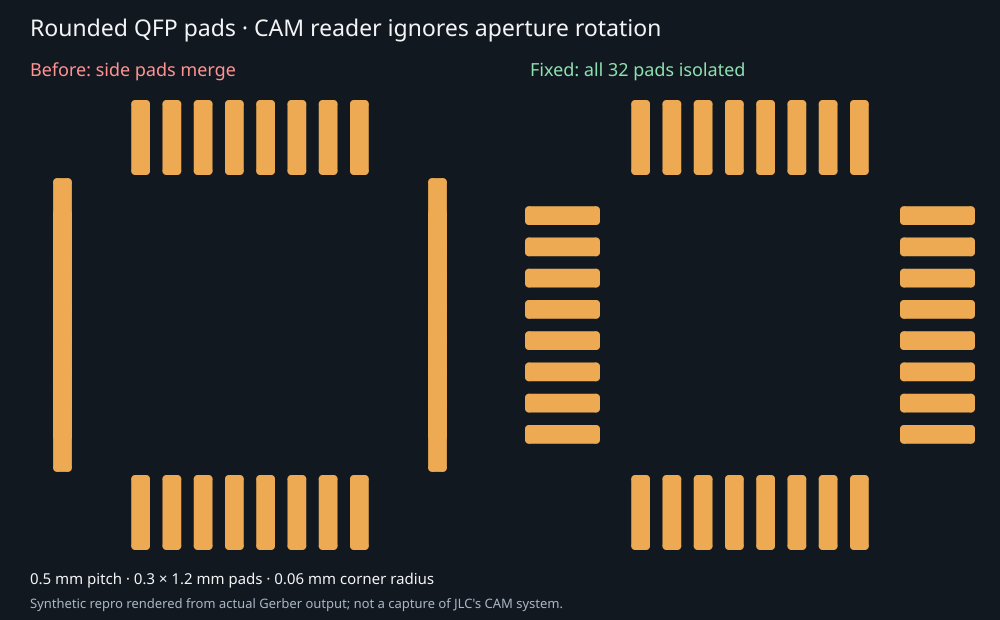
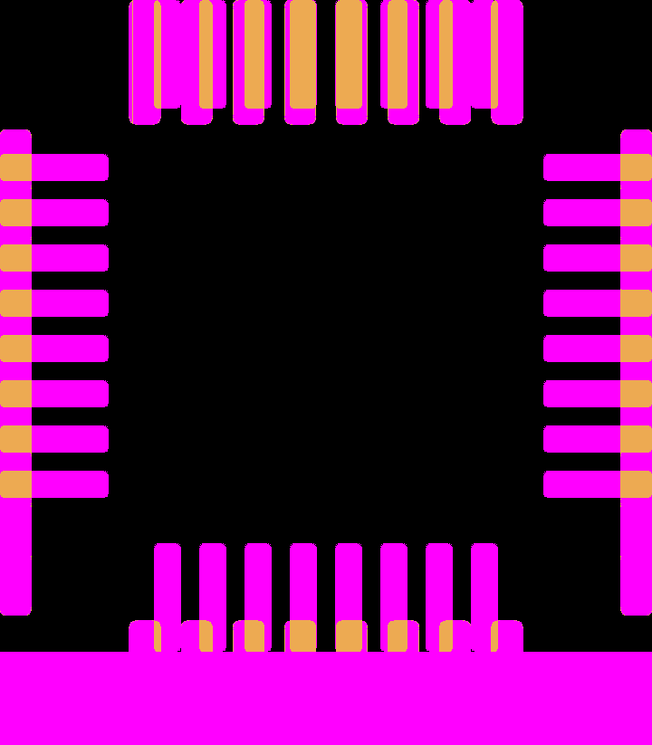

# Rounded QFP fabrication rotation repro

32 isolated rounded rectangular SMT pads, 0.5 mm pitch, 0.3 × 1.2 mm,
0.06 mm corner radius. The left and right rows rotate the pads 90°/270°.

`before.F_Cu.gbr` was captured from main at
`34b217cd4e7e8e4a7b59428a8d65b3cf1667c076` using this fixture. It relies on
`%LR` commands for rounded rectangular pads. If a CAM reader ignores those
commands, each side row merges into one copper strip: 18 islands instead of 32.

The fix rotates the rounded rectangle macro's corner coordinates, preserving
exact circular corners and the single-flash SMD pad aperture function, without
requiring LR. `after.F_Cu.gbr` and `comparison.svg` are generated from the fixed
exporter. Both panels deliberately strip LR to simulate an incompatible CAM
reader; this is not evidence of how JLC processed the reporter's original board.
The original board/parts are still needed to confirm that exact failure.

Run:

```sh
bun test tests/gerber/rounded-qfp-cam-rotation.test.ts
bun tests/repros/repro12/render-rounded-qfp.ts
```

The regression independently parses/rasterizes the actual Gerbers and counts
connected copper islands. It also covers top/bottom copper, soldermask margins,
Y-axis reflection, negative and non-cardinal rotations, and visual snapshots.



## Stacked snapshot review

The repro PR adds `rounded-qfp-visual-repro.test.ts` and captures the broken
output on main. The fix PR leaves that visual test unchanged and updates its
four existing SVG snapshots (top/bottom copper and mask). Running the fixed code
against the repro snapshots fails both visual tests before updating them.

The image below compares the same baseline and fixed top-copper geometry using
`@tscircuit/image-utils/looks-same` (Resvg rasterizes the SVGs):


