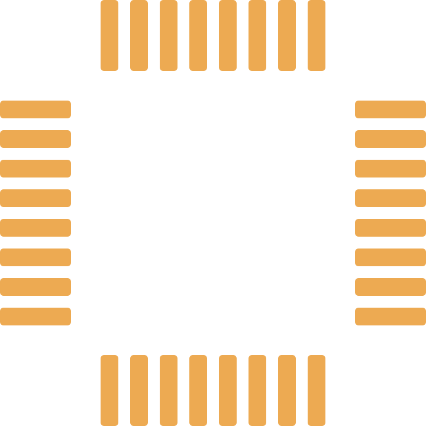

# Rounded QFP fabrication rotation repro

32 isolated rounded rectangular SMT pads, 0.5 mm pitch, 0.3 × 1.2 mm,
0.06 mm corner radius. Left/right rows rotate their apertures 90°/270°.

This PR captures the current exporter output without modifying production code.
The snapshot renderer ignores LR for these apertures: the side rows merge into
solid copper strips (18 islands instead of 32 isolated pads). This simulates the
reported CAM compatibility failure; it is not a capture of JLC's CAM system.
The original board/parts are still needed to confirm that exact report.

Run `bun test tests/gerber/rounded-qfp-visual-repro.test.ts`.
The fix PR updates these same four copper/mask SVG snapshots so its Files Changed
view provides a real before/after image diff.

